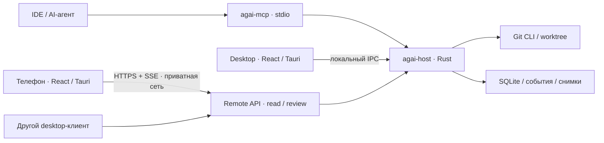

# ADR-0001: React, устанавливаемые клиенты и удалённый host

Дата: 29 октября 2026. Статус: рекомендуемая архитектура для плана MVP; реализация не начата.
Основание: [ТЗ 0.4](../superpowers/specs/2026-10-29-awesomegitai-design.md), уточнение пользователя о desktop/mobile/remote и предложение использовать React.

## Решение

React + TypeScript + Vite для интерфейса; Tauri 2 для desktop и мобильной оболочки; отдельный Rust-процесс `agai-host` для репозитория, истории и MCP-доступа. React в Tauri отображается в системном WebView. Это устанавливаемое приложение с локально поставляемым интерфейсом, а не сайт, требующий сервера для открытия. Полностью нативные системные виджеты этот выбор не обещает.

На компьютере host запускается рядом с приложением. На удалённой машине может работать без графического интерфейса. На телефоне host и Git не запускаются: телефон — клиент выбранного host. Один host владеет своей SQLite и снимками; клиенты не открывают базу напрямую. Мобильные и desktop-компоненты разделяют типы, темы, состояние ревью и отображение кода, но не обязаны иметь одинаковую раскладку.

## Альтернативы

| Вариант | Польза для продукта | Цена и решение |
| --- | --- | --- |
| React + Tauri 2 на desktop/mobile | Общие компоненты чтения кода; React-экосистема; системный WebView | Проверять WebKit/WebView2/Android WebView отдельно; выбрать для MVP после технической проверки |
| React + Electron desktop, React Native mobile | Стабильная Chromium-среда desktop; отдельный мобильный UI | Две оболочки и разные компоненты редактора; резерв, если Tauri не проходит критические проверки |
| Flutter desktop/mobile | Общий UI без HTML/WebView | Dart и больше собственной работы над code/diff UI; не выбирать при текущем предпочтении React |

Рекомендация основана на задачах продукта, а не на замере, которого ещё не было. M0 проверяет этот выбор до реализации основной логики. React Native не выбран автоматически: React-компоненты для DOM не становятся компонентами React Native.

## Стек

| Область | Решение |
| --- | --- |
| UI | React, TypeScript strict, Vite; CSS variables и Gruvbox Dark Hard; React Aria Components для доступных базовых элементов |
| Код и diff | CodeMirror 6, `@codemirror/merge`; единый read-only editor, decorations для объяснений/trace, отдельная модель staging из Git |
| Подсветка | TS/JS и Python — грамматики CodeMirror; C# — проверенная C-like stream grammar как начало. Семантические цвета по символам — отдельный language adapter после MVP |
| Граф и схемы | Виртуализированный список + SVG lanes для Git DAG; React Flow + ELK для структурированных диаграмм. Сырые HTML/SVG агента не исполняются |
| Клиентское состояние | TanStack Query для запросов; небольшой Zustand store для вкладок/панелей; без копирования всей истории в store |
| Native shell | Tauri 2; Swift/Kotlin только для платформенных возможностей, прежде всего защищённого хранилища |
| Host | Rust stable, Tokio, Axum, serde; никаких зависимостей domain-ядра от Tauri |
| Git | Установленный Git CLI; вызовы аргументами, без shell. libgit2/gix не добавлять вторым движком в MVP |
| Данные | SQLite WAL, rusqlite, FTS5; версионированные миграции; снимки до 2 MiB/файл в той же транзакционной базе для простоты durable-записи |
| MCP | Официальный Rust SDK `rmcp`; stdio и loopback Streamable HTTP gateways к host; один writer, независимо от количества IDE |
| Контракт | Rust DTO + JSON Schema + сгенерированные TypeScript-типы; `schemaVersion=1`; fixture-совместимость в CI |
| Remote | HTTPS JSON + SSE событий через native transport; Tailscale Serve для первого приватного подключения |
| Сборка | Cargo workspace + pnpm workspace; Cargo.lock/pnpm-lock.yaml и точные toolchains фиксируются результатом M0 |
| Проверки | Rust unit/integration на настоящих временных Git-репозиториях; Vitest/Testing Library; Playwright для React UI; WebdriverIO Tauri service/embedded driver для desktop; проверки упакованного Tauri на реальных ОС/устройствах |

Monaco не делаем единым редактором: его официальный FAQ прямо исключает поддержку мобильных браузеров/frameworks. CodeMirror остаётся кандидатом, который должен пройти реальные touch/selection/accessibility проверки, а не обещанием идеального мобильного UX.

## Компоненты и доверие

Локальный IPC: Unix domain socket на macOS/Linux, named pipe на Windows; доступ текущего OS-пользователя. Сообщения — JSON records с request ID; один сериализованный writer. Desktop имеет локальные Git-команды. MCP имеет только чтение и запись агентских метаданных. Remote имеет только чтение разрешённых репозиториев и пользовательские отметки ревью. Principal и permissions определяет транспорт/host, клиент не выбирает их в payload.

Удалённый API — отдельный listener и отдельный allowlist маршрутов. Он не проксирует произвольные локальные RPC или MCP tools. Ключи Git/SSH остаются на host и не выдаются телефону.

## Remote MVP

1. Пользователь включает remote на host. По умолчанию listener выключен; после включения слушает только loopback.
2. Tailscale Serve публикует этот listener внутри tailnet по HTTPS. Требуются установка/настройка Tailscale и учётная запись у него; аккаунт AwesomeGitAi не нужен. Публичный Funnel не используется.
3. Через desktop UI или локальную CLI на host создаётся одноразовое pairing-приглашение: 256 бит случайности, срок 5 минут, список разрешённых repo IDs. QR содержит HTTPS-адрес и invitation, не Git credentials.
4. Телефон обменивает invitation на запрос привязки. Host показывает имя устройства и запрошенные репозитории; пользователь подтверждает на host через UI либо `agai-admin pair approve ID` в SSH-сессии. Только затем выдаётся отдельный случайный device token. Сервер хранит его hash; invitation одноразовый. Попытки ограничены по частоте.
5. Scope: `repo.read`, `history.read`, `review.write`. Последний означает «просмотрено», а не принятие агентского решения, не stage и не разрешение запуска команды. Credentials хранятся native-кодом: iOS Keychain; Android Keystore защищает ключ шифрования хранимого token. В DOM/localStorage токен не попадает.
6. SSE несёт монотонный event sequence. При разрыве клиент продолжает с курсора; при истёкшем курсоре получает `resync_required` и заново читает закреплённый снимок. Событие смены snapshot не подменяет открытый код без уведомления.
7. Отзыв устройства блокирует новые запросы и закрывает его поток. При отключённом host отображается offline, а не ложное «данные актуальны».

Для headless bootstrap поставляется локальная CLI `agai-admin`: регистрация repo, включение remote, приглашение/подтверждение/отзыв устройств. Она работает через user-scoped IPC; администрирование по SSH выполняется на самой машине от владельца host-профиля, не через mobile API.

MVP remote — доступ к машине с установленным host; это не удалённый рабочий стол и не подключение к произвольному SSH-серверу без установки. Предлагаемый поддерживаемый unattended-host: Linux x64. Локальный host macOS/Windows работает, пока пользовательская сессия/процесс доступны; закрытие окна не обязано завершать его, явный Quit завершает. Настройка автозапуска добровольная. Спящий ноутбук не отвечает; круглосуточная работа требует включённой машины.

На мобильном для первого релиза данные держатся в памяти приложения; после cold start без сети показывается состояние подключения, а не сохранённый репозиторий. Постоянный offline-cache кода и offline-запись ревью отложены до отдельного этапа шифрования, удаления и синхронизации. Desktop выполняет требование offline из ТЗ полностью. Отзыв доступа не может удалить данные, уже прочитанные пользователем/сохранённые вне приложения.

## Платформы и мобильный UX

- Desktop MVP: macOS Apple Silicon и Windows x64, Linux desktop — техническая сборка без обещания полной поддержки в первом выпуске.
- Host: macOS/Windows локально, Linux x64 для удалённого запуска.
- Mobile MVP: Android и iOS, обязательные проверки на физических устройствах. Порядок beta: Android, затем iOS; общая приёмка расширенного MVP включает оба.
- Точные минимальные ОС, версии WebView и Git утверждаются по результатам M0 и записываются в compatibility.md; до этого широкая «поддержка всех версий» не заявляется.
- Desktop: код в центре, объяснение справа, Git Log снизу. Телефон: один файл, unified diff, объяснение по tap/bottom sheet, отдельный экран веток/коммитов, вкладки переменных/стека. Планшет возвращает боковую панель при достаточной ширине.
- Мобильное приложение не клонирует репозиторий и не запускает агент, build или debugger. В MVP оно получает снимки/историю и играет сохранённый учебный trace.

## Границы выпуска

**D — Desktop MVP:** весь набор MVP ТЗ 0.4 (A01–A29), macOS/Windows, минимум две доказанные harness-интеграции, stdio и Streamable HTTP.
**R — Connected MVP:** D + headless host + remote API + Android/iOS companion. Это завершение нового расширенного запроса; D не выдаётся за готовность мобильной версии.
**После R:** remote Git mutations/запуск задач агента, собственный relay и аккаунты, push notifications, persistent mobile offline-cache, полноценный Git 1.0, реальные debugger traces.

Первый MCP-host для проверки — Rider с JetBrains AI Assistant, подключение stdio; второй независимый harness (предлагается Cursor) проверяет HTTP. Транспорты имеют общий набор инструментов. Наличие функции в документации не равно успешному тесту нашего сервера: M0 фиксирует установленную версию/доступность, M3 выполняет реальный сценарий. Если host недоступен, выбрать другой независимый harness и записать замену, не объявляя недоступный продукт проверенным; минимум два остаётся обязательным.

## Источники, проверены 29 октября 2026

- [Tauri: платформы, frontend и системный WebView](https://v2.tauri.app/start/).
- [Flutter: поддерживаемые платформы](https://docs.flutter.dev/reference/supported-platforms) — рассмотренная альтернатива.
- [Monaco: FAQ, mobile не поддерживается](https://github.com/microsoft/monaco-editor#faq).
- [CodeMirror: основной репозиторий](https://github.com/codemirror/dev), [компонент merge](https://github.com/codemirror/merge).
- [React Native: отдельные native-компоненты](https://reactnative.dev/docs/intro-react-native-components).
- [Официальный MCP Rust SDK](https://github.com/modelcontextprotocol/rust-sdk).
- [JetBrains AI Assistant: внешние MCP и транспорты](https://www.jetbrains.com/help/ai-assistant/mcp.html).
- [Tailscale Serve: приватный доступ, HTTPS и ACL](https://tailscale.com/docs/features/tailscale-serve).
- [Tauri WebDriver: ограничения платформенного тестирования](https://v2.tauri.app/develop/tests/webdriver/).

Библиотеки в таблице — проектный выбор; версии, footprint, скорость, touch-качество и публикация в stores ещё не проверены. Тарифы/условия внешних сервисов не включены в оценку.

## Уточнение подключения агента

MCP не является необязательным плагином. [Контракт](../integrations/mcp-contract.md) определяет встроенный guide, tool descriptions/inputSchema, шаблон правил и примеры. HTTP MCP имеет отдельный scope/listener от mobile API и доступен локально; public remote MCP/OAuth позже. Monaco 15 px для основного UI, 14 px для кода и минимум 12 px для подписей, fallback при отсутствии шрифта.
